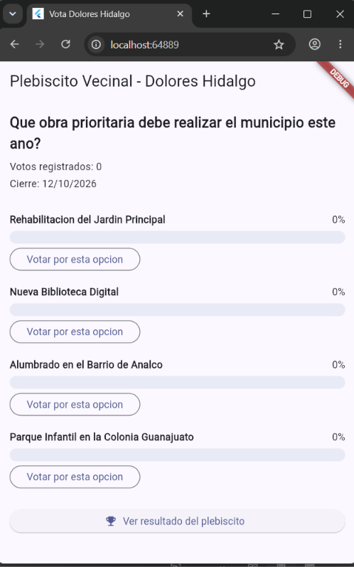
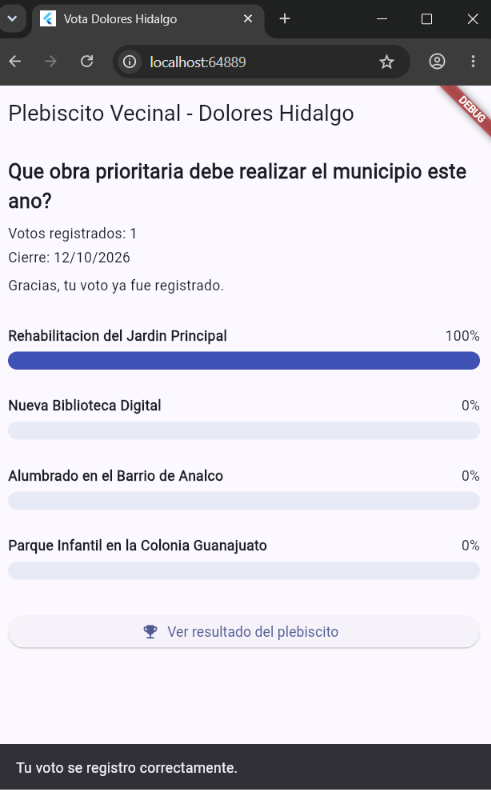
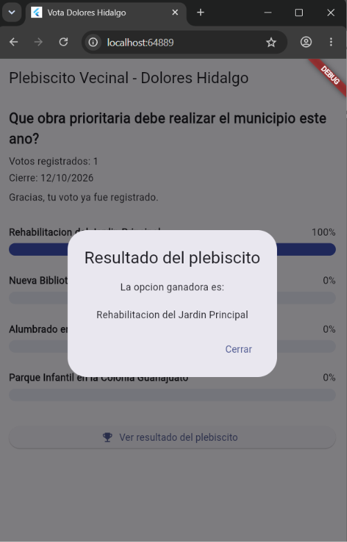
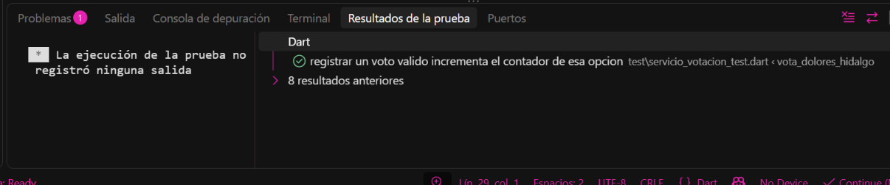
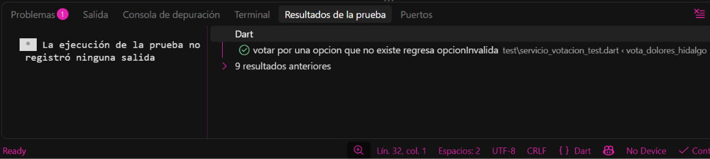
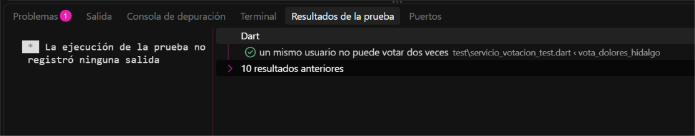
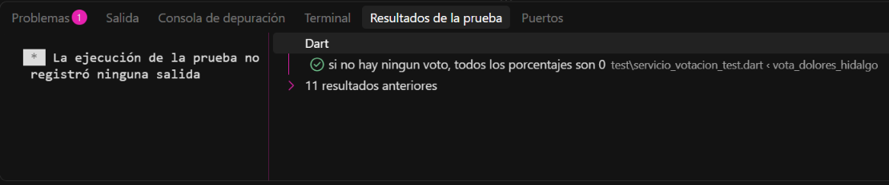
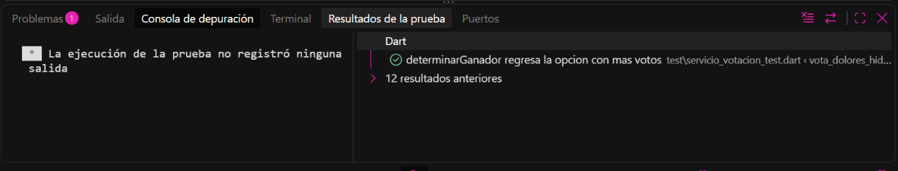
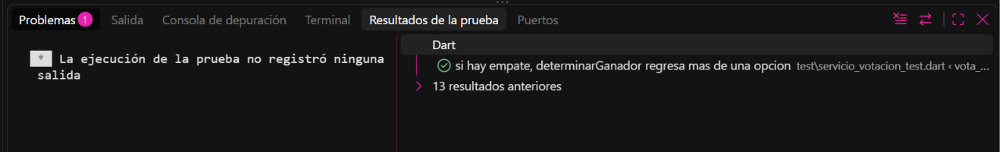
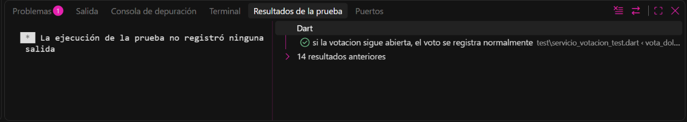

# 🗳️ Vota Dolores Hidalgo

Plebiscito vecinal digital con gráficas animadas, construido **100 % con TDD** (Test-Driven Development) en Flutter/Dart.

> Proyecto complementario de práctica TDD — *Desarrollo Móvil Integral*.

El municipio propone una pregunta —**¿Qué obra prioritaria debe realizar el municipio este año?**— y los vecinos votan por su opción favorita:

- Rehabilitación del Jardín Principal
- Nueva Biblioteca Digital
- Alumbrado en el Barrio de Analco
- Parque Infantil en la Colonia Guanajuato

Los resultados se muestran en **barras que crecen con animación suave** y, al consultar el resultado, el ganador se revela con una **animación de escala y aparición**.

---

## 📱 Capturas de la aplicación

### Pantalla inicial
La votación recién abierta: 0 votos registrados, fecha de cierre visible y todas las opciones en 0 %, cada una con su botón **Votar por esta opción**.

<p align="center">
  
</p>

### Voto registrado
Después de votar, la app confirma con un mensaje, oculta los botones de voto (un usuario solo puede votar una vez) y la barra de la opción elegida se anima hasta el **100 %**.

<p align="center">
  
</p>

### Revelación del ganador
Al presionar **Ver resultado del plebiscito** aparece un diálogo con animación de rebote (`Curves.elasticOut`) combinada con desvanecido (`FadeTransition`). Si hay empate, se listan todas las opciones empatadas.

<p align="center">
  
</p>

---

##  Reglas de negocio protegidas con pruebas

| # | Regla | Resultado esperado |
|---|-------|--------------------|
| 1 | Un voto válido incrementa el contador de la opción | `ResultadoVoto.exitoso` |
| 2 | Solo se puede votar por una opción existente | `ResultadoVoto.opcionInvalida` |
| 3 | Cada usuario vota una sola vez | `ResultadoVoto.usuarioYaVoto` |
| 4 | Los porcentajes son correctos, incluso sin votos (sin `NaN`) | 75 % / 25 %, o 0 % si no hay votos |
| 5 | El ganador es la opción con más votos | `determinarGanador()` |
| 6 | Un empate se reconoce como empate, no se elige al azar | Lista con varias opciones |
| 7 | No se puede votar después de la fecha de cierre | `ResultadoVoto.votacionCerrada` |

---

##  Ciclo TDD: Rojo → Verde → Refactor

Cada ronda se escribió primero como una prueba que falla (🔴), luego el mínimo código para pasarla (🟢) y, al final, un refactor (🔵). Las siguientes capturas muestran la prueba de cada ronda en verde dentro del panel *Resultados de la prueba*; el contador de «resultados anteriores» crece conforme se suman pruebas, y las anteriores nunca se rompen.

### Ronda 1 — Registrar un voto válido
Prueba: `registrar un voto valido incrementa el contador de esa opcion`.



### Ronda 2 — Rechazar votos a opciones que no existen
Prueba: `votar por una opcion que no existe regresa opcionInvalida`. Elimina el frágil operador `!` de la ronda anterior.



### Ronda 3 — Un usuario no puede votar dos veces
Prueba: `un mismo usuario no puede votar dos veces`. El segundo intento regresa `usuarioYaVoto` y no incrementa ninguna opción.



### Ronda 4 — Calcular resultados con porcentajes
Prueba: `si no hay ningun voto, todos los porcentajes son 0`. Evita la división entre cero (`NaN`) cuando nadie ha votado.



### Ronda 5 — Determinar el ganador
Prueba: `determinarGanador regresa la opcion con mas votos`.



### Ronda 6 — Reconocer un empate
Prueba: `si hay empate, determinarGanador regresa mas de una opcion`. Pasa sin cambiar código, pero se conserva como red de seguridad.



### Ronda 7 — No se puede votar después del cierre
Prueba: `si la votacion sigue abierta, el voto se registra normalmente`, junto con la prueba de votación cerrada.



### Ronda 8 — Refactor final
Guard clauses con nombres descriptivos (`yaCerro`, `yaVoto`) para que `registrarVoto()` se lea como una lista de reglas de negocio. Sin cambios de comportamiento: todas las pruebas siguen en verde.

---

## 🗂️ Estructura del proyecto

```
lib/
  modelos/
    opcion_votacion.dart
    votacion.dart
    resultado_opcion.dart
  logica/
    resultado_voto.dart
    servicio_votacion.dart
  presentation/
    votacion_screen.dart      # interfaz animada
  main.dart
test/
  servicio_votacion_test.dart
```

`lib/modelos/` y `lib/logica/` son **Dart puro**: toda la lógica está probada sin depender de Flutter. La animación vive solo en la última capa y nunca duplica reglas de negocio.

---

## 🚀 Cómo ejecutarlo

```bash
git clone <url-del-repositorio>
cd vota_dolores_hidalgo
flutter pub get

# Ejecutar las pruebas
flutter test

# Ejecutar la app
flutter run
```

---

## 🧪 Pruebas

El archivo `test/servicio_votacion_test.dart` incluye las pruebas de las 7 rondas más una **prueba de integración** que simula un plebiscito completo (varios vecinos votan, un intento duplicado no cuenta y se determina el ganador).

---

## 🏆 Retos de extensión

- [ ] Inyectar un «reloj» (`DateTime Function()`) en `ServicioVotacion` para probar el cierre sin depender de la fecha real.
- [ ] Límite de votantes totales (el voto 501 se rechaza).
- [ ] Modo de votación anónima (solo se guarda que el usuario ya votó).
- [ ] Animación de confeti con `CustomPainter` al revelar un ganador sin empate.
- [ ] Persistir los votos con `shared_preferences`.

---

## 🛠️ Tecnologías

- Flutter / Dart
- `flutter_test`
- Animaciones nativas: `TweenAnimationBuilder`, `ScaleTransition`, `FadeTransition`
